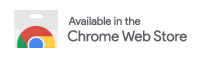
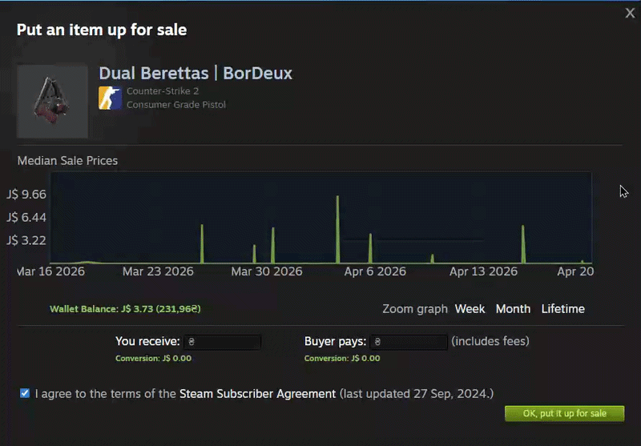
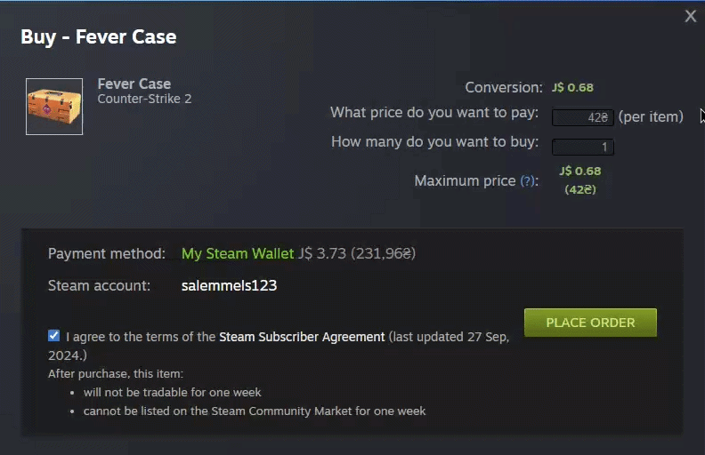
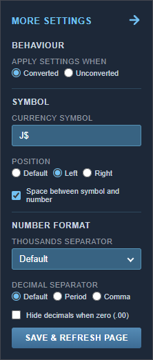

<div align="center">


# Steam Currency Converter

A browser extension that converts Steam prices to your preferred currency as you browse. Works across the store, community market, and checkout.

<a href="https://chromewebstore.google.com/detail/steam-currency-converter/kkpmhkmhbcdkagimlpcofbffhmdppmmb">
  
</a><a href="https://addons.mozilla.org/en-US/firefox/addon/steam_currency_converter">
  
</a>

</div>

## Overview

Real-time currency conversion built right into Steam, with no tab switching and no interruptions. It supports **164 currencies** and works across the store, community market, and checkout. On top of conversion, it adds a few quality-of-life features: hover to compare, full market dialog support, and formatting controls that make the numbers look the way you're used to.

## What it does

You pick a source currency (what your Steam wallet uses) and a target currency (what you want to see). The extension then rewrites every price on the page in your target currency, live, without a refresh. Content that loads in later, like search results, bundle items, and market listings, gets converted too.

On the Community Market it goes further: wallet balance, the buy/sell dialogs, and the price history graph tooltips all update to your chosen currency.

Exchange rates come from [exchangerate-api.com](https://exchangerate-api.com). They're fetched once a day and cached locally. If the API is unreachable, the extension uses the last cached rate, and if it has never fetched one, it leaves prices as they are rather than showing a wrong number.


## Getting Started

1. Install the extension
2. Open the popup by clicking the extension icon
3. Set **Store currency** (the currency your Steam store charges you in)
4. Set **Convert to** (the currency you want to see)

That's it. Changes save as you make them, and Steam tabs that are already open switch over right away, without a reload.

## Installation

### Browser

**Chrome:** Install from the [Chrome Web Store](https://chromewebstore.google.com/detail/steam-currency-converter/kkpmhkmhbcdkagimlpcofbffhmdppmmb).

**Firefox:** Install from [Firefox Add-ons](https://addons.mozilla.org/en-US/firefox/addon/steam-currency-converter/), then allow access to the Steam sites from the extension's **Permissions** tab in `about:addons`.

To install without the stores, see [Install from source](#install-from-source).

### Install from source

You can run the extension straight from this repository instead of installing it from a store, for example to try a change before it's published. First get the code, either with `git clone https://github.com/brullee/steam-currency-converter.git` or with **Code → Download ZIP** on GitHub (extract it afterwards).

#### Chrome, Edge, Brave and other Chromium browsers

1. Go to `chrome://extensions` (or `edge://extensions`, `brave://extensions`) and turn on **Developer mode**.
2. Click **Load unpacked** and select the repo folder.

To update, get the new code, click the reload button on the extension's card, and refresh any open Steam tabs.

#### Firefox

1. Go to `about:debugging` and click **This Firefox**.
2. Click **Load Temporary Add-on** and select `manifest.firefox.json` in the repo folder.
3. In `about:addons`, open the extension's **Permissions** tab and allow access to the Steam sites.

Firefox removes temporary add-ons when it closes, so you'll need to load it again after a restart. Regular Firefox only installs signed add-ons permanently. Firefox Developer Edition and Nightly can install unsigned ones if you set `xpinstall.signatures.required` to `false` in `about:config`: zip the `background`, `content`, `icons`, `popup` and `shared` folders together with `manifest.firefox.json` renamed to `manifest.json` at the top of the zip, then use **Install Add-on From File** in `about:addons`.

### Steam Client

You can run this extension directly inside the Steam desktop client using two community tools:

1. Install **[Millennium](https://github.com/SteamClientHomebrew/Millennium)**, a plugin loader for the Steam client
2. Install the **[Extendium](https://github.com/BossSloth/Extendium)** plugin via Millennium, which adds Chrome extension support to Steam
3. Load this extension through Extendium, the same way you would in Chrome (see [Install from source](#install-from-source))

> **Note:** This isn't officially supported by Valve and may violate their terms of service. Use it at your own risk.


## What's included

### Hover to Compare

Every converted price is interactive. Hover over one and it temporarily switches back to the original Steam price, so you can compare without toggling anything.


If you'd rather not have this, you can turn it off with a checkbox in the popup. Prices stay converted, just without the hover.


### Community Market Support

When you open a buy or sell dialog on the Community Market, the extension adds a live preview of the converted price: what you receive, what the buyer pays, and the order total. The previews update as you type, so you know the real amount in your currency before you confirm. The price history graph in the sell dialog is converted too.





### Custom Number Formatting & Symbols

Each currency comes with sensible local defaults, like German-style `2,64 €` or Vietnamese `312.000₫`. You can override any of it: set your own thousands and decimal separators, drop `.00` from round numbers, or replace the symbol with any text you like. You can also choose the symbol's position (left or right) and whether it has a space.

There are two separate sets of these settings, picked with the switch at the top of **More settings**: one for converted prices and one for Steam's own prices wherever they appear (on hover, in wallet balances, and when conversion is off). The switch names them after your currencies, e.g. **JOD prices | USD prices**. So you can, for example, show converted prices as `JD 12.50` while the hover shows `US$ 9.99`.

If your Steam store shows prices with a trailing `USD` (e.g. `$9.99 USD`), the **Hide "USD" after prices** checkbox removes it. It's useful even when you're not converting, just to make prices tidier.




## Configuration

The popup has two layers of settings.

**Basic:**
- Source and target currency
- Toggle conversion on/off
- Hover to reveal the original price
- Hide "USD" after prices (for stores that show `$9.99 USD`)

**Formatting (under "More settings"):** two separate sets, one for converted prices and one for Steam's own prices (on hover, in wallet balances, and when conversion is off). Each has:
- Custom symbol text, position (left/right), and spacing
- Thousands and decimal separators
- Hiding `.00` on round numbers


## Technical notes

- Manifest V3, Chrome and Firefox
- Prices are detected with a regex built per currency that handles symbol position, regional separators, non-breaking spaces, and alternate symbols (e.g. PHP shows `₱` in search but `P` on game pages)
- Each converted text node is tracked in a WeakMap (original text, converted text, rate), so the MutationObserver skips it on later passes and never converts the same text twice
- Hover targets and their text nodes are cached in a WeakMap, so the DOM isn't walked again on every mouse event
- Settings apply live: the popup saves every change, and each open tab listens for `storage.onChanged`, puts Steam's original text back, and converts again with the new settings
- If the background service worker has been shut down, the content script retries the rate request once to wake it


## Tests

The `tests/` folder is self-contained and isn't part of the shipped extension.

```bash
cd tests
npm install
npm test            # unit tests: content scripts in jsdom
npm run test:e2e    # end-to-end: the Chrome build in Google Chrome, on fixture pages served at Steam URLs
npm run test:live   # the same build against the real Steam store and rate API (needs network)
```

The e2e and live suites use Google Chrome from its default install location. Set `BROWSER=helium` to use Helium, `BROWSER_PATH` to use any other Chromium-based browser, or `HEADED=1` to watch the tests run. The e2e suite uses fixed exchange rates, so it runs offline, like the unit tests.

GitHub Actions runs the unit and e2e suites on every push and pull request, and the live suite once a week. That way, a change to Steam's pages or an outage of the rate API gets caught even when nobody is working on the code.


## AI-assisted development

This repo is set up for [Claude Code](https://claude.com/claude-code):

- `CLAUDE.md` holds the project rules.
- `.claude/skills/` has a `verify` skill (runs the tests and checks none were weakened) and a `check-live` skill (runs the live suite).
- `.claude/hooks/` stops Claude from pushing and keeps its commit messages short and free of AI attribution.

AI-made changes go through the same tests and CI as hand-written ones.


## Disclaimer

This extension is meant to give you a general idea of prices. Rates are updated daily, but accuracy isn't guaranteed. Some currencies are spot on while others can be a bit off, and the prices shown may not always be current or error-free. Double-check before making any purchase where it matters. By using this extension you hereby accept that I'm not responsible for any loss or inconvenience resulting from it.


## Issues

Something broken or a currency behaving oddly? [Open an issue](https://github.com/brullee/steam-currency-converter/issues/new).

## License

Open source under the [MIT License](LICENSE).
